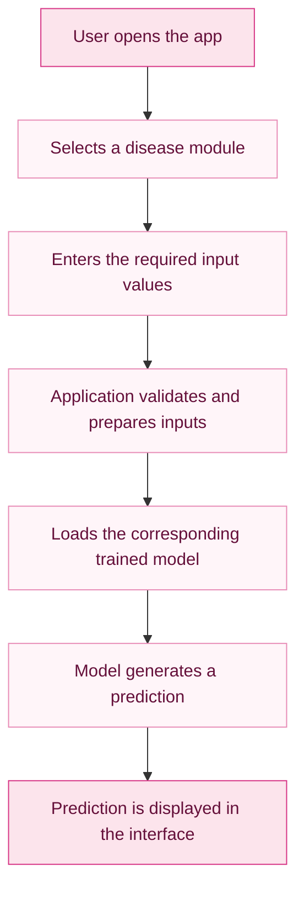

# 💗 Health Assistant ML

<p align="center">
  
</p>

<p align="center">
  <strong>Better Data · Healthier Tomorrows</strong>
  <br>
  An interactive machine learning application for exploring predictions related to diabetes, heart disease, and Parkinson's disease.
</p>

<p align="center">
  
  
  
  
</p>

<p align="center">
  <a href="#-features">Features</a> ·
  <a href="#-technology-stack">Tech Stack</a> ·
  <a href="#-getting-started">Installation</a> ·
  <a href="#-how-it-works">How It Works</a>
</p>

---

## 🌸 About the Project

**Health Assistant ML** is a machine learning-based web application built with Python and Streamlit. It provides a simple interface where users can enter selected health-related measurements and obtain model-generated predictions for three disease categories.

The application brings multiple trained machine learning models together in one place, with a user interface designed to make interacting with the models straightforward.

### ✨ What makes it useful?

- **Three prediction modules:** Diabetes, heart disease, and Parkinson's disease.
- **Interactive interface:** Enter input values through a web dashboard.
- **Pre-trained models:** Load saved machine learning models for predictions.
- **Organized datasets:** Includes datasets and notebooks used in the project.
- **Accessible experience:** A visual interface built with Streamlit.

> **Important:** This project is for educational and experimental purposes only. Its predictions are not medical diagnoses and must not replace professional medical advice, screening, or treatment.

---

## 💖 Features

<table>
  <tr>
    <td width="50%" valign="top">

### 🩸 Diabetes Prediction

Uses selected health and medical measurements as input to a trained machine learning model.

**Example inputs**
- Glucose level
- Blood pressure
- BMI
- Insulin level
- Age and other model features

    </td>
    <td width="50%" valign="top">

### ❤️ Heart Disease Prediction

Provides a model-generated prediction based on the supported heart disease input features.

**Designed for**
- Structured numerical inputs
- Model-based prediction
- Simple result presentation

    </td>
  </tr>
  <tr>
    <td colspan="2" valign="top">

### 🧠 Parkinson's Disease Prediction

Uses the input features expected by the saved Parkinson's disease model to generate a prediction.

The exact feature names and input requirements depend on the trained model used by the application.

    </td>
  </tr>
</table>

### 🎨 User Interface

- Soft pink and white visual theme
- Sidebar navigation between prediction modules
- Clearly labelled input fields
- Dedicated prediction buttons and result areas
- Medical-inspired icons and dashboard styling

---

## 🖥️ Application Preview

<p align="center">
  
</p>

<p align="center">
  <em>A clean, pink-themed dashboard for interacting with the prediction models.</em>
</p>

---

## 🛠️ Technology Stack

| Technology | Purpose |
|---|---|
| Python | Application logic and model integration |
| Streamlit | Interactive web interface |
| NumPy | Numerical computing |
| Pandas | Data handling and analysis |
| Scikit-learn | Machine learning model support |
| Pickle | Loading saved model objects |
| Jupyter Notebook | Model experimentation and training workflows |
| CSV | Dataset storage |

---

## ⚙️ How It Works



The application follows a straightforward prediction workflow:

1. The user selects a prediction module from the sidebar.
2. The application collects the input values required by that module.
3. The values are passed to the corresponding saved machine learning model.
4. The model returns a prediction.
5. The interface displays the result.

The diagram represents the intended workflow; input validation and error handling should be verified against the current implementation.

---

## 📂 Project Structure

```text
health-assistant-ml/
│
├── .streamlit/
│   └── config.toml
│
├── assets/
│   └── health-assistant-preview.png
│
├── colab_files_to_train_models/
│   ├── Multiple disease prediction system - Parkinsons.ipynb
│   ├── Multiple disease prediction system - diabetes.ipynb
│   └── Multiple disease prediction system - heart.ipynb
│
├── dataset/
│   ├── diabetes.csv
│   ├── heart.csv
│   └── parkinsons.csv
│
├── saved_models/
│   ├── diabetes_model.sav
│   ├── heart_disease_model.sav
│   └── parkinsons_model.sav
│
├── app.py
├── requirements.txt
├── README.md
└── .gitignore
```

---

## 🚀 Getting Started

Follow these steps to run the application locally.

### 1. Prerequisites

Install:

- Python 3.11
- Git
- A code editor such as Visual Studio Code

Python 3.11 is recommended for compatibility with the project's pinned dependencies.

### 2. Clone the repository

```bash
git clone https://github.com/alina01washim-aw/health-assistant-ml.git
```

Navigate into the project folder:

```bash
cd health-assistant-ml
```

### 3. Create a virtual environment

**Windows PowerShell**

```powershell
py -3.11 -m venv venv
.\venv\Scripts\Activate.ps1
```

If you use Command Prompt instead:

```cmd
venv\Scripts\activate.bat
```

### 4. Install dependencies

```bash
python -m pip install --upgrade pip
pip install -r requirements.txt
```

### 5. Launch the application

```bash
python -m streamlit run app.py
```

Streamlit will provide a local URL, usually:

```text
http://localhost:8501
```

Open that URL in your browser to use the application.

---

## 📊 Datasets and Model Files

The repository contains CSV datasets and serialized model files for the three prediction modules. Jupyter notebooks are also included for exploring the model-training workflows.

- `dataset/` contains the supplied CSV data.
- `saved_models/` contains the saved model objects loaded by the application.
- `colab_files_to_train_models/` contains the associated notebooks.

The model algorithms, training configuration, evaluation metrics, and prediction performance should be confirmed from the notebooks and evaluation results before reporting them.

---

## 🔮 Future Improvements

Potential areas for further development include:

- [ ] Add input validation and clearer error messages.
- [ ] Document each model's expected features and units.
- [ ] Report verified model evaluation metrics.
- [ ] Improve accessibility and mobile responsiveness.
- [ ] Add automated tests for input handling and prediction functions.
- [ ] Add model versioning and reproducible training instructions.
- [ ] Explore deployment so the app can be accessed through a public URL.

---

## ⚠️ Medical Disclaimer

Health Assistant ML is an educational machine learning project, not a clinically validated medical device.

Predictions may be incorrect or unreliable and must not be used to diagnose, prevent, or treat a medical condition. Do not make healthcare decisions based on this application. Consult a qualified healthcare professional for medical advice.

The project has not been established as clinically validated merely by running its models.

---


<p align="center">
  <strong>Health Assistant ML</strong>
  <br>
  Built with Python, Streamlit, and machine learning.
  <br><br>
  <sub>Learning through data. Building with purpose.</sub>
</p>