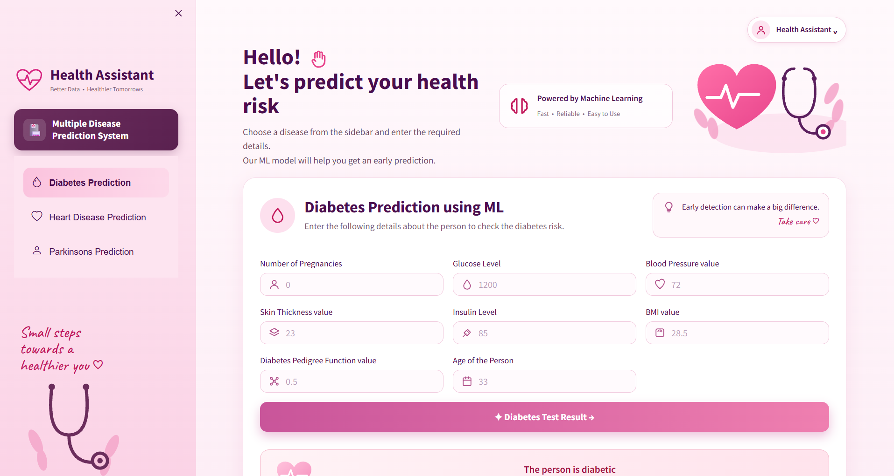
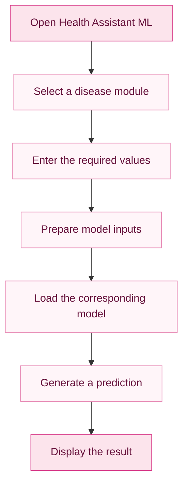

# 💗 Health Assistant ML

<p align="center">
  
</p>

<p align="center">
  <strong>Better Data · Healthier Tomorrows</strong>
  <br>
  A machine learning web application for exploring predictions related to diabetes, heart disease, and Parkinson's disease.
</p>

<p align="center">
  
  
  
  
</p>

<p align="center">
  <a href="#-about-the-project">About</a> •
  <a href="#-features">Features</a> •
  <a href="#-technology-stack">Tech Stack</a> •
  <a href="#-getting-started">Installation</a> •
  <a href="#-future-improvements">Roadmap</a>
</p>

---

## 🌸 About the Project

**Health Assistant ML** is a Python-based web application built with Streamlit that brings three machine learning prediction modules together in one interface.

Users can select a disease category, enter the required health-related measurements, and view a prediction generated by the corresponding trained model.

The project combines machine learning, data handling, and interactive UI development in a simple application designed for learning and experimentation.

### ✨ Project Highlights

- Three disease prediction modules in one application.
- Interactive forms for entering model inputs.
- Pre-trained machine learning models loaded from saved files.
- Dedicated datasets and Jupyter notebooks.
- A custom pink-and-white medical dashboard.
- Simple navigation and clearly presented prediction results.

---

## 💖 Features

<table>
  <tr>
    <td align="center" width="33%">
      <h3>🩸</h3>
      <h3>Diabetes Prediction</h3>
      Enter supported medical measurements and obtain a prediction from the trained diabetes model.
    </td>
    <td align="center" width="33%">
      <h3>❤️</h3>
      <h3>Heart Disease Prediction</h3>
      Submit the required health-related inputs to generate a model-based prediction.
    </td>
    <td align="center" width="33%">
      <h3>🧠</h3>
      <h3>Parkinson's Prediction</h3>
      Use the supported input features to generate a prediction from the Parkinson's model.
    </td>
  </tr>
</table>

### 🎀 Interface and Experience

- Soft pink and white color palette.
- Sidebar navigation for switching between disease modules.
- Clearly labelled input fields.
- Dedicated prediction buttons and result sections.
- Medical-inspired illustrations and icons.
- Streamlit-powered interactive interface.

---

## 🖥️ Application Preview

<p align="center">
  
</p>

<p align="center">
  <em>One dashboard. Three prediction modules. A simpler way to interact with machine learning models.</em>
</p>

---

## 🛠️ Technology Stack

<p align="center">
  
  
  
  
  
  
</p>

| Technology | Purpose |
|---|---|
| Python | Application logic and model integration |
| Streamlit | Interactive web interface |
| NumPy | Numerical operations |
| Pandas | Data manipulation and analysis |
| Scikit-learn | Machine learning model support |
| Pickle | Loading serialized model objects |
| Jupyter Notebook | Model development and experimentation |
| CSV | Dataset storage |

---

## ⚙️ How It Works



### Prediction Workflow

1. Open the application.
2. Select Diabetes, Heart Disease, or Parkinson's Prediction.
3. Enter the values requested by the selected form.
4. Submit the inputs to the corresponding model.
5. View the generated prediction in the application.

The actual input features and model behavior depend on the selected prediction module and its saved model.

---

## 📂 Project Structure

```text
health-assistant-ml/
│
├── .streamlit/
│   └── config.toml
│
├── assets/
│   └── health-assistant-preview.png
│
├── colab_files_to_train_models/
│   ├── Multiple disease prediction system - Parkinsons.ipynb
│   ├── Multiple disease prediction system - diabetes.ipynb
│   └── Multiple disease prediction system - heart.ipynb
│
├── dataset/
│   ├── diabetes.csv
│   ├── heart.csv
│   └── parkinsons.csv
│
├── saved_models/
│   ├── diabetes_model.sav
│   ├── heart_disease_model.sav
│   └── parkinsons_model.sav
│
├── app.py
├── requirements.txt
├── README.md
└── .gitignore
```

---

## 🚀 Getting Started

Run the application locally by following these steps.

### Prerequisites

- Python 3.11 recommended
- Git
- A code editor such as Visual Studio Code

### 1. Clone the repository

```bash
git clone https://github.com/alina01washim-aw/health-assistant-ml.git
```

### 2. Open the project directory

```bash
cd health-assistant-ml
```

### 3. Create a virtual environment

For Windows PowerShell:

```powershell
py -3.11 -m venv venv
.\venv\Scripts\Activate.ps1
```

For Windows Command Prompt:

```cmd
venv\Scripts\activate.bat
```

### 4. Install dependencies

```bash
python -m pip install --upgrade pip
pip install -r requirements.txt
```

### 5. Run the application

```bash
python -m streamlit run app.py
```

Streamlit will display a local URL in your terminal. Open it in your browser, usually:

```text
http://localhost:8501
```

You can now interact with the available prediction modules.

---

## 📊 Datasets and Saved Models

The project includes CSV datasets, serialized model files, and Jupyter notebooks.

| Directory | Contents |
|---|---|
| `dataset/` | Diabetes, heart disease, and Parkinson's datasets |
| `saved_models/` | Saved models used by the application |
| `colab_files_to_train_models/` | Notebooks associated with model training and experimentation |
| `assets/` | Application preview image |

The model algorithms, training details, evaluation scores, and accuracy should be verified from the notebooks and evaluation results before being reported.

---

## 🔮 Future Improvements

- [ ] Add more detailed input validation and error handling.
- [ ] Document the input features and units for each model.
- [ ] Evaluate models using appropriate metrics and test data.
- [ ] Improve accessibility and responsive layouts.
- [ ] Add automated tests for prediction functions.
- [ ] Improve model versioning and reproducibility.
- [ ] Deploy the application for public access.

---

## ⚠️ Medical Disclaimer

Health Assistant ML is an educational machine learning project. It is **not a clinically validated diagnostic system**.

Its predictions may be inaccurate and must not be used to diagnose, prevent, or treat any disease. The application does not replace professional medical advice, examination, or treatment. Consult a qualified healthcare professional for medical concerns.

---

<p align="center">
  <h3>💗 Health Assistant ML</h3>
  <strong>Better Data · Healthier Tomorrows</strong>
  <br><br>
  Built with Python, Streamlit, and machine learning.
</p>
